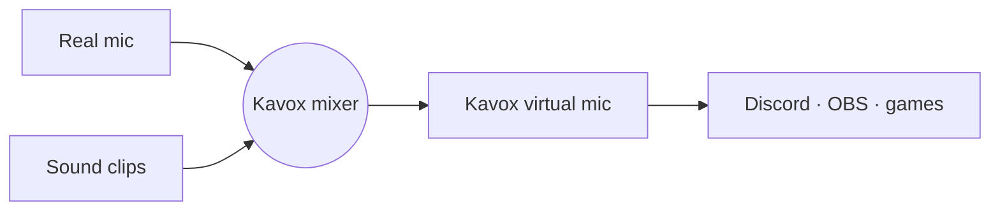

  

  
  
  
  

  <a href="#what-this-repo-is">About</a> ·
  <a href="#how-it-works">How it works</a> ·
  <a href="#status">Roadmap</a>

---

A free, open-source soundboard and voice changer, built as an alternative to Voicemod.

Kavox = **Ka**rel + **vox** (Latin for "voice").

## What this repo is

Voicemod gates most of its soundboard and voice effects behind a paid plan. Kavox aims to give you the same core features with no payment or account:

- **Soundboard**: play audio clips into calls, games and streams with global hotkeys.
- **Virtual microphone**: apps like Discord, OBS and games pick "Kavox" as their mic and hear your real voice mixed with the clips.
- **Voice effects** (later): pitch shift, robot, reverb, echo and similar real-time effects.

## How it works

Kavox creates a virtual audio device, then mixes two things into it:

On Linux this uses PipeWire/PulseAudio: a null sink plus a virtual source (`pactl load-module module-null-sink` / `module-virtual-source`, or `pw-loopback`). Kavox plays clips into that sink and routes your mic into it.

## Status

Early stage. The repo only has this README so far.

Planned order:

1. Linux (PipeWire) soundboard with a virtual mic and hotkeys
2. Basic voice effects (pitch, reverb, echo)
3. Windows support (needs VB-Cable or VoiceMeeter, since userland apps can't create virtual devices there)
4. AI voice conversion (maybe, needs a GPU)

## Not a goal

- Paid tiers, accounts or telemetry
- Replacing a full DAW or audio router

## Related tools

If you want something that works today on Linux: Soundux (soundboard), EasyEffects (mic effects) and qpwgraph/Helvum (routing).
