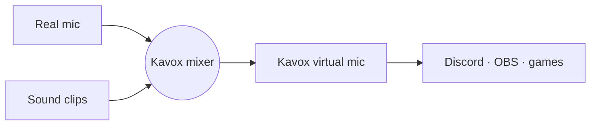

<p align="center">
  
</p>

<p align="center">
  
  
  
  
</p>

<p align="center">
  <a href="#what-this-repo-is">About</a> ·
  <a href="#how-it-works">How it works</a> ·
  <a href="#status">Roadmap</a> ·
  <a href="docs/PRD.md">PRD</a> ·
  <a href="docs/TECH.md">Tech design</a>
</p>

---

A free, open-source soundboard and voice changer, built as an alternative to Voicemod.

Kavox = **Ka**rel + **vox** (Latin for "voice").

## What this repo is

Voicemod gates most of its soundboard and voice effects behind a paid plan. Kavox aims to give you the same core features with no payment or account:

- **Soundboard**: play audio clips into calls, games and streams with global hotkeys.
- **Virtual microphone**: apps like Discord, OBS and games pick "Kavox" as their mic and hear your real voice mixed with the clips.
- **Voice effects** (later): pitch shift, robot, reverb, echo and similar real-time effects.

## How it works

Kavox creates a virtual audio device, then mixes two things into it:



- **Windows:** Kavox writes into a virtual audio cable ([VB-CABLE](https://vb-audio.com/Cable/), free) and your voice app uses "CABLE Output" as its mic. Windows has no way for a normal app to create a mic device, so the cable is a one-time install.
- **Linux:** Kavox creates its own "Kavox Mic" through PipeWire/PulseAudio when it starts and removes it when it quits.

Details are in the [technical design](docs/TECH.md).

## Status

**v0.1 is built** and runs on Linux. Windows builds but still needs testing on real hardware. See the [PRD](docs/PRD.md) and [technical design](docs/TECH.md).

Done:

- **v0.1:** pads with drag-to-reorder, global hotkeys, mic passthrough with clock-drift correction, headphone monitor, setup wizard, tray, `kavoxctl` CLI
- **From v0.2:** multiple boards, loudness normalization, loop mode, launch on login

Next:

1. Push-to-talk assist (Windows), Wayland global shortcuts portal, board export/import, auto-update
2. Installers and code signing
3. Basic voice effects (pitch, reverb, echo)
4. AI voice conversion (maybe, needs a GPU)

## Development

You need Rust (stable) and Node.js 22+.

- **Linux:** `webkit2gtk-4.1`, `libpulse` (PulseAudio, or PipeWire with pipewire-pulse) and `libayatana-appindicator` for the tray.
- **Windows:** WebView2 (built into Windows 11) and [VB-CABLE](https://vb-audio.com/Cable/) to hear sounds in voice apps.

```sh
npm install
npx tauri dev                 # run the app
cargo test --workspace        # engine, library, persistence and controller tests
npx tauri build               # installers in target/release/bundle
```

Other tools:

- `cargo run -p kavoxctl -- play airhorn` controls a running Kavox (see Settings → Hotkeys for compositor bindings).
- `cargo run -p kavox-core --example spike -- probe` measures how long a sound takes to reach the virtual mic.
- `npm run dev`, then open `http://localhost:1420/preview.html?view=main` to work on the UI with a mocked backend. Other values: `wizard`, `settings`, `editor` and `empty`, plus `&platform=linux` and `&theme=light`.

## Not a goal

- Paid tiers, accounts or telemetry
- Replacing a full DAW or audio router

## Related tools

If you want something that works today on Linux: Soundux (soundboard), EasyEffects (mic effects) and qpwgraph/Helvum (routing).
