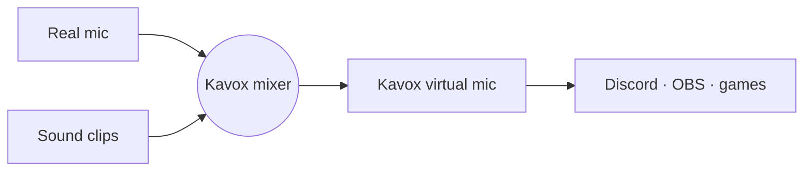

<p align="center">
  
</p>

<p align="center">
  
  
  
  
  <a href="LICENSE"></a>
</p>

<p align="center">
  <a href="#what-this-repo-is">About</a> ·
  <a href="#how-it-works">How it works</a> ·
  <a href="#status">Roadmap</a> ·
  <a href="docs/PRD.md">PRD</a> ·
  <a href="docs/TECH.md">Tech design</a> ·
  <a href="#license">License</a>
</p>

---

A free, open-source soundboard and voice changer for Windows and Linux.

Kavox = **Ka**rel + **vox** (Latin for "voice").

## What this repo is

Most soundboard and voice changer apps keep their best features behind a subscription. Kavox aims to give you the core features with no payment or account:

- **Soundboard**: play audio clips into calls, games and streams with global hotkeys.
- **Virtual microphone**: apps like Discord, OBS and games pick "Kavox" as their mic and hear your real voice mixed with the clips.
- **Voice effects** (later): pitch shift, robot, reverb, echo and similar real-time effects.

## How it works

Kavox creates a virtual audio device, then mixes two things into it:



- **Windows:** Kavox writes into a virtual audio cable ([VB-CABLE](https://vb-audio.com/Cable/), free) and your voice app uses "CABLE Output" as its mic. Windows has no way for a normal app to create a mic device, so the cable is a one-time install.
- **Linux:** Kavox creates its own "Kavox Mic" through PipeWire/PulseAudio when it starts and removes it when it quits.

Details are in the [technical design](docs/TECH.md).

## Status

**v0.1 is built** and runs on Linux. Windows builds but still needs testing on real hardware. See the [PRD](docs/PRD.md) and [technical design](docs/TECH.md).

Done:

- **v0.1:** pads with drag-to-reorder, global hotkeys, mic passthrough with clock-drift correction, headphone monitor, setup wizard, tray, `kavoxctl` CLI
- **From v0.2:** multiple boards, loudness normalization, loop mode, launch on login

Next:

1. Push-to-talk assist (Windows), Wayland global shortcuts portal, board export/import, auto-update
2. Installers and code signing
3. Basic voice effects (pitch, reverb, echo)
4. AI voice conversion (maybe, needs a GPU)

## Install

There are no downloadable installers yet. The install scripts build Kavox from source and install it for your user only, with no admin rights needed. The first build takes a few minutes.

### Windows 10 and 11

1. Install [VB-CABLE](https://vb-audio.com/Cable/), the free virtual cable Kavox plays into so Discord and games can hear your sounds. Unzip it, right-click `VBCABLE_Setup_x64.exe`, choose **Run as administrator**, click **Install Driver**, and restart if asked.
2. Open PowerShell and run:

   ```powershell
   git clone https://github.com/Aitemaa/Kavox.git
   cd Kavox
   powershell -ExecutionPolicy Bypass -File scripts\install.ps1 -InstallDeps
   ```

   `-InstallDeps` uses winget to install whatever is missing: Rust, Node.js and the Visual Studio C++ build tools. If it installs anything, open a new PowerShell window, `cd` back into the Kavox folder, and run the same command without `-InstallDeps`.

   No git? On GitHub, choose **Code → Download ZIP**, unzip it, and run the script from that folder.
3. Kavox opens when the install finishes and walks you through setup. Next time, start it from the Start menu.

Kavox goes into `%LOCALAPPDATA%\Programs\Kavox`, and `kavoxctl` is on your PATH in new terminal windows.

To uninstall:

```powershell
powershell -ExecutionPolicy Bypass -File scripts\install.ps1 -Uninstall
```

### Linux

```sh
git clone https://github.com/Aitemaa/Kavox.git
cd Kavox
./scripts/install.sh --deps
```

`--deps` installs build dependencies with pacman, apt or dnf, and asks for your password. Leave it off if you already have Rust 1.88+, Node.js 20.19+ and the development packages for webkit2gtk-4.1 and libpulse.

This puts `kavox` and `kavoxctl` in `~/.local/bin` and adds Kavox to your app launcher. Set `PREFIX` to install somewhere else. Kavox needs PulseAudio, or PipeWire with pipewire-pulse. It creates its own "Kavox Mic" while it runs, so there's no driver to install.

To uninstall, run `./scripts/install.sh --uninstall`. Your sounds and settings stay in `~/.config/io.github.aitemaa.kavox` and `~/.local/share/io.github.aitemaa.kavox` until you delete them.

### Updating and packages

To update on either platform, run `git pull` in the Kavox folder and run the install script again.

To build distributable packages instead, run `npm install`, then `npx tauri build`. Installers land in `target/release/bundle/`: NSIS on Windows; `.deb`, `.rpm` and AppImage on Linux.

## Development

You need Rust 1.88+ and Node.js 20.19+.

- **Linux:** `webkit2gtk-4.1`, `libpulse` (PulseAudio, or PipeWire with pipewire-pulse) and `libayatana-appindicator` for the tray.
- **Windows:** WebView2 (built into Windows 11) and [VB-CABLE](https://vb-audio.com/Cable/) to hear sounds in voice apps.

```sh
npm install
npx tauri dev                 # run the app
cargo test --workspace        # engine, library, persistence and controller tests
npx tauri build               # installers in target/release/bundle
```

Other tools:

- `cargo run -p kavoxctl -- play airhorn` controls a running Kavox (see Settings → Hotkeys for compositor bindings).
- `cargo run -p kavox-core --example spike -- probe` measures how long a sound takes to reach the virtual mic.
- `npm run dev`, then open `http://localhost:1420/preview.html?view=main` to work on the UI with a mocked backend. Other values: `wizard`, `settings`, `editor` and `empty`, plus `&platform=linux` and `&theme=light`.

## Not a goal

- Paid tiers, accounts or telemetry
- Replacing a full DAW or audio router

## Related tools

If you want something that works today on Linux: Soundux (soundboard), EasyEffects (mic effects) and qpwgraph/Helvum (routing).

## License

Kavox is free software. You can use, change and share it under the [GNU General Public License v3.0 or later](LICENSE). If you share a changed version, you have to publish its source code under the same license.

Copyright © 2026 Ignatius Karel.

Discord, OBS, VB-CABLE, VoiceMeeter and other product names mentioned here are trademarks of their owners. Kavox is an independent project and isn't affiliated with or endorsed by any of them.
