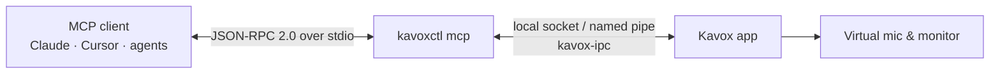

# Kavox MCP Server

Kavox includes a built-in [Model Context Protocol (MCP)](https://modelcontextprotocol.io/) stdio server inside `kavoxctl`, allowing AI assistants and coding agents (Claude Desktop, Claude Code, Cursor, T3 Code, and any stdio MCP client) to control a running Kavox instance live.

## How it works



- **Zero extra runtime or dependencies:** `kavoxctl mcp` runs out of the same small native Rust binary already installed on your `PATH` by `./scripts/install.sh` or `scripts\install.ps1`.
- **Live GUI sync:** Every change made through MCP goes through Kavox's controller (`kavox-core`), so the desktop window, tray, active board, voice changer controls, mixer sliders, and pad indicators stay in sync immediately.
- **Protocol compatibility:** Implements newline-delimited JSON-RPC 2.0 over stdin/stdout with protocol version negotiation for `2025-06-18`, `2025-03-26`, and `2024-11-05`.

## Setup

1. Install or update Kavox so both `kavox` and `kavoxctl` are built and on your `PATH`:
   - **Linux:** `./scripts/install.sh`
   - **Windows:** `powershell -ExecutionPolicy Bypass -File scripts\install.ps1`
2. Start the **Kavox** desktop app. (`kavoxctl mcp` talks to the running app over its local IPC socket; if Kavox is closed, tool calls return a clear `isError: true` message asking you to launch it.)
3. Register `kavoxctl mcp` in your MCP client.

### Generic MCP client config (`mcpServers`)

Works with Claude Desktop, Cursor, Windsurf, and most MCP clients:

```json
{
  "mcpServers": {
    "kavox": {
      "command": "kavoxctl",
      "args": ["mcp"]
    }
  }
}
```

If your MCP client doesn't inherit `~/.local/bin` (Linux) or `%LOCALAPPDATA%\Programs\Kavox` (Windows) in its `PATH`, use the full path to `kavoxctl`:

- **Linux:** `/home/<user>/.local/bin/kavoxctl`
- **Windows:** `C:\\Users\\<user>\\AppData\\Local\\Programs\\Kavox\\kavoxctl.exe`

### Claude Code

```sh
claude mcp add kavox -- kavoxctl mcp
```

### Running from a source checkout

```json
{
  "mcpServers": {
    "kavox": {
      "command": "cargo",
      "args": ["run", "-q", "--manifest-path", "/path/to/Kavox/Cargo.toml", "-p", "kavoxctl", "--", "mcp"]
    }
  }
}
```

## Tools

All sound and board `target` parameters accept an exact ID, a case-insensitive exact name, or a unique case-insensitive name prefix.

### Status & discovery

| Tool | Arguments | Description |
|---|---|---|
| `get_status` | *(none)* | Returns live Kavox state: active board, all boards, currently playing sounds (with progress), mic mute and mixer gains, voice changer state and available presets, virtual mic status, active streams, and audio devices. |
| `list_sounds` | `board?`: string<br/>`query?`: string<br/>`playing_only?`: boolean | Lists sounds across the library with IDs, boards, durations, volumes, hotkeys, loop/retrigger settings, and `playing` state. Optionally filter by board name/ID, name substring, or currently playing clips. |
| `list_boards` | *(none)* | Lists all boards with IDs, names, sound counts, and active indicator. |

### Playback & boards

| Tool | Arguments | Description |
|---|---|---|
| `play_sound` | `target`: string *(required)* | Plays a clip into the virtual mic and monitor, respecting the pad's retrigger mode (`restart`, `overlap`, or `toggle`). |
| `stop_sound` | `target`: string *(required)* | Stops all active playback instances of the matching sound. |
| `stop_all_sounds` | *(none)* | Immediately stops every currently playing sound. |
| `set_active_board` | `target`: string *(required)* | Switches the active soundboard in Kavox. |
| `show_window` | *(none)* | Shows and focuses the Kavox desktop window. |

### Microphone, voice changer & mixer

| Tool | Arguments | Description |
|---|---|---|
| `set_mic_mute` | `mode?`: `"on" \| "off" \| "toggle"` (default `"toggle"`) | Mutes, unmutes, or toggles microphone passthrough into the virtual mic. |
| `set_voice_changer` | `enabled?`: boolean<br/>`preset?`: `"normal" \| "custom" \| "chipmunk" \| "pixie" \| "deep" \| "giant" \| "monster" \| "wobbly" \| "drunk" \| "alien"`<br/>`semitones?`: number (`-12` to `12`)<br/>`hear_myself?`: boolean | Controls the live voice changer. Picking a named preset automatically enables the voice changer unless `enabled: false` is passed; picking `"normal"` disables it unless `enabled: true`. Passing `semitones` without `preset` switches to `"custom"` and enables it unless `enabled: false`. |
| `set_mixer` | `mic_muted?`: boolean<br/>`mic_passthrough?`: boolean<br/>`mic_gain?`: number (`0.0`–`2.0`)<br/>`sounds_to_mic_gain?`: number (`0.0`–`2.0`)<br/>`sounds_to_monitor_gain?`: number (`0.0`–`2.0`)<br/>`monitor_enabled?`: boolean<br/>`normalize?`: boolean<br/>`global_volume_override?`: boolean<br/>`global_sound_volume?`: number (`0.0`–`2.0`) | Patches any subset of live mixer gains and audio toggles (`1.0` = 100% unity gain). Unspecified fields are left unchanged. |

## Resources

| URI | MIME type | Description |
|---|---|---|
| `kavox://status` | `application/json` | Live Kavox status snapshot (same payload as `get_status`). |
| `kavox://sounds` | `application/json` | Full soundboard library listing (same payload as `list_sounds` with no filters). |

## CLI equivalents

The same expanded IPC commands are also available directly from `kavoxctl`:

```sh
kavoxctl play <name|id>
kavoxctl stop <name|id>
kavoxctl stop-all
kavoxctl mute [on|off|toggle]
kavoxctl list
kavoxctl boards
kavoxctl board <name|id>
kavoxctl voice on|off|<preset>
kavoxctl voice pitch <semitones>
kavoxctl status
kavoxctl mcp
```
