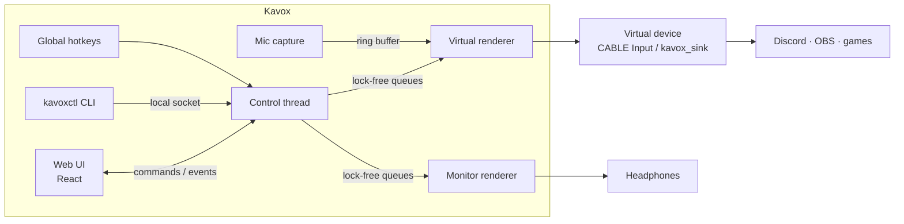

# Kavox Soundboard: Technical Design

| | |
|---|---|
| **Implements** | [PRD.md](PRD.md) |
| **Platforms** | Windows 10/11 (primary), Linux with PipeWire or PulseAudio |
| **Status** | v0.1 implemented; Linux verified, Windows compiles but is untested on hardware |

---

## 1. Overview

Kavox is a Tauri 2 desktop app. A Rust core owns all audio work: it decodes clips, mixes them with the user's mic, and writes the result into a virtual audio device that voice apps use as a microphone. A second output sends the clips to the user's headphones. A web UI (React + TypeScript) talks to the core through Tauri commands and events.



## 2. Stack

| Concern | Choice | Why |
|---|---|---|
| App shell | **Tauri 2** | Small installers (single-digit MB), native webview, first-class Windows + Linux support, plugins for tray, hotkeys and updates |
| Core language | **Rust** | Real-time safe audio without a GC, same code on both OSes |
| Windows audio I/O | **cpal** (WASAPI shared mode) | Mature, picks devices by name, callback-based |
| Linux audio I/O | **libpulse-binding** + **libpulse-simple-binding** | Works on PulseAudio and PipeWire (via pipewire-pulse), can target a specific sink and load modules for the virtual mic |
| Decoding | **symphonia** | Pure Rust; WAV, MP3, OGG Vorbis, FLAC (AAC/M4A behind a feature flag) |
| Resampling | **rubato** (clip import) | FFT resampler converts clips to each device's rate; the mic path uses a small linear interpolator with a drift-corrected ratio, which is cheap and plenty for voice |
| Real-time queues | **rtrb** | Wait-free SPSC ring buffers for commands, mic samples and events |
| Loudness (P1) | **ebur128** | Integrated LUFS for normalization |
| Hotkeys | **tauri-plugin-global-shortcut** | `RegisterHotKey` on Windows, X11 on Linux |
| Single instance | **tauri-plugin-single-instance** | Second launch focuses the existing window |
| Local IPC | **interprocess** | Named pipe on Windows, Unix socket on Linux, for `kavoxctl` |
| Key injection (P1) | **windows** crate (`SendInput`) | PTT assist |
| Logging | **tracing** + **tracing-appender** | Structured logs, daily rolling file |
| Frontend | **React 18 + TypeScript + Vite**, **Zustand** for state, **dnd-kit** for reordering | Familiar, small, well supported |

**Alternatives considered**

- **C# / .NET + NAudio:** best Windows audio library, but no workable Linux story for the audio layer.
- **Electron:** easier web tooling, but 80–100 MB installers and higher idle memory (fails NFR-5/NFR-6).
- **Python + Qt:** fast to prototype, but GC pauses in the audio path and awkward Windows packaging.
- **cpal on Linux too:** cpal goes through ALSA there and can't target a specific Pulse/PipeWire sink, which the virtual mic needs.

## 3. Repository layout

```
Kavox/
├── crates/
│   ├── kavox-core/          # audio engine, library, settings; no Tauri dependency
│   │   ├── src/
│   │   │   ├── engine/      # renderer (mixer + voices), mic drift, limiter, meters, gain smoothing
│   │   │   ├── backend/     # AudioBackend trait + wasapi.rs + pulse.rs (+ null.rs elsewhere)
│   │   │   ├── clip.rs      # decode, resample, loudness, cache, background loader
│   │   │   ├── controller.rs# streams, voices, retrigger, hotkey conflicts, saving, UI events
│   │   │   ├── library.rs   # boards, sounds, import, name lookup
│   │   │   ├── settings.rs
│   │   │   └── persist.rs   # atomic JSON writes, .bak recovery, schema migrations
│   │   └── examples/spike/  # M0 prototype; its `probe` command measures trigger→mic latency
│   ├── kavox-ipc/           # local socket protocol shared by the app and kavoxctl
│   └── kavoxctl/            # tiny CLI: play / stop / stop-all / mute / list
├── src-tauri/               # Tauri app: commands, events, tray, hotkeys, signals
├── src/                     # React frontend (+ preview.tsx: UI with a mocked backend)
├── docs/
└── assets/
```

Keeping the engine in `kavox-core` lets it be unit tested without a webview. The IPC types live in their own crate so `kavoxctl` stays tiny and starts in milliseconds.

## 4. Threads

| Thread | Real-time? | Job |
|---|---|---|
| **Main / UI** | No | Tauri event loop, webview, tray |
| **Control** | No | Owns `AppState`; turns commands (UI, hotkeys, IPC) into engine messages; tracks active voices; persists state; emits UI events |
| **Virtual renderer** | **Yes** | Mixes clips + mic into the virtual device |
| **Monitor renderer** | **Yes** | Mixes clips into the headphones |
| **Mic capture** | **Yes** | Pushes mic samples into the mic ring buffer |
| **Loader pool** | No | Decodes and resamples clips (2 worker threads) |
| **Device watcher** | No | Polls devices every 2 s, triggers stream rebuilds |
| **IPC server** | No | Accepts `kavoxctl` connections |

On Windows the real-time threads are cpal's WASAPI callback threads. On Linux they are our own threads looping blocking `pa_simple` reads/writes, promoted to real-time priority via rtkit when available.

## 5. Audio engine

### 5.1 Signal flow

```
                      ┌──────────────── sounds-to-mic gain ───┐
clip voices ──────────┤                                        ├─► Σ ─► limiter ─► virtual device
                      │      mic ─► mic gain ─► mute ──────────┘
                      │
                      └──────────────── sounds-to-monitor gain ──► Σ ─► limiter ─► monitor device
```

The mic is not sent to the monitor (users hear themselves through their own head anyway, and it causes echo with open speakers).

### 5.2 Internal format

- Mixing is **32-bit float, interleaved stereo**, at each output device's native sample rate (usually 48 kHz).
- The mic is downmixed to mono and added equally to both channels.
- Devices that only accept other formats (i16, more channels) are converted at the edge in the backend.

### 5.3 Clip loading

```rust
pub struct ClipData {
    pub sound_id: SoundId,
    pub sample_rate: u32,
    pub frames: usize,
    pub samples: Box<[f32]>, // interleaved stereo
}
```

1. **Import** (control thread → loader pool): copy the file to `sounds/<id>.<ext>`, probe it with symphonia, reject unsupported or corrupt files, record duration and peak. P1: compute integrated loudness and store `norm_gain_db` targeting −16 LUFS, capped at +12 dB.
2. **Decode**: decode to stereo f32 at the file's native rate.
3. **Resample**: for each distinct output rate in use, resample once with rubato's synchronous sinc resampler. Usually both outputs run at 48 kHz, so there is only one copy.
4. **Cache**: `ClipCache` maps `(SoundId, rate) → Arc<ClipData>`.
   - Clips ≤ 30 s are decoded at startup in the background and stay resident.
   - Longer clips are decoded on first play and kept in an LRU with a 150 MB budget. The first play of a long clip has a short delay (shown as a loading spinner on the pad).
   - v0.2: stream long clips from a decoder thread instead, with a 2 s resident head so first play is instant.

If a device's rate changes (new device selected), the cache resamples for the new rate in the background. Pads show a loading state until ready.

### 5.4 Renderer, voices and commands

Each output stream has its own `Renderer`. The control thread sends the same commands to both renderers, so sounds start together without sharing state across two device clocks.

```rust
pub enum Command {
    Play { voice: VoiceId, sound: SoundId, clip: Arc<ClipData>, gain: f32, looping: bool },
    Stop { voice: VoiceId },
    StopSound { sound: SoundId },
    StopAll,
    SetBusGain { bus: Bus, gain: f32 },   // Bus::Sounds | Bus::Mic
    SetMicMuted(bool),
}

pub enum EngineEvent {
    Started { voice: VoiceId, sound: SoundId },
    Progress { voice: VoiceId, frame: usize },   // throttled to ~15 Hz
    Ended { voice: VoiceId, sound: SoundId },
}

struct Voice {
    id: VoiceId,
    sound: SoundId,
    clip: Arc<ClipData>,
    pos: usize,              // frame index
    gain: SmoothedGain,
    looping: bool,
    fade_out: Option<u32>,   // frames left in the stop fade
}

pub struct Renderer {
    voices: arrayvec::ArrayVec<Voice, 32>,
    commands: rtrb::Consumer<Command>,
    events: rtrb::Producer<EngineEvent>,
    garbage: rtrb::Producer<Arc<ClipData>>,
    mic: Option<MicInput>,   // only on the virtual renderer
    bus: BusGains,
    limiter: Limiter,
    meters: Arc<Meters>,
}

impl Renderer {
    /// Called by the backend with an interleaved stereo buffer to fill.
    pub fn render(&mut self, out: &mut [f32]) { /* drain commands, mix, limit, meter */ }
}
```

Per buffer, `render`:

1. Drains all pending commands.
2. Zeros `out`, then adds each voice: `out[i] += clip[pos + i] * voice_gain * sounds_bus_gain`. Gains ramp linearly across the buffer when they change (no zipper noise).
3. Applies stop fades (10 ms linear), advances positions, loops or ends voices.
4. Adds the mic (virtual renderer only, see §5.6).
5. Runs the limiter and updates meters.
6. Moves finished voices' `Arc<ClipData>` into the `garbage` queue so the control thread drops them. **The audio thread never frees memory.**

**Retrigger modes** are resolved on the control thread, which tracks active voices per sound from `Started`/`Ended` events (the virtual renderer is authoritative; the monitor renderer's events are ignored except when no virtual device is open):

| Mode | Sound not playing | Sound playing |
|---|---|---|
| Restart | `Play` | `StopSound` then `Play` |
| Overlap | `Play` | `Play` |
| Toggle | `Play` | `StopSound` |

Active-voice state can lag by one buffer (~10 ms), which is acceptable.

**Voice limit:** 32 per renderer. When full, the oldest voice gets a 5 ms fade and its slot is reused.

### 5.5 Real-time rules

Code that runs inside `render` or capture callbacks must not:

- allocate or free memory (no `Vec::push`, `Box::new`, `Arc` drops of the last reference),
- take locks (`Mutex`, `RwLock`) or do blocking channel operations,
- log, print, or do any I/O,
- call into the OS beyond what the backend does.

Enforcement: `assert_no_alloc` wraps `render` in debug builds and tests. Counters for underruns and dropped commands are atomics read by the control thread.

### 5.6 Mic passthrough and clock drift

The mic and the virtual device run on different hardware clocks. Even at "the same" 48 kHz they drift by tens of ppm, so over hours a naive buffer would underflow (crackles) or overflow (growing delay).

```
mic callback ─► rtrb ring (mono or stereo, mic's rate) ─► async resampler ─► virtual renderer
                         ▲                                        ▲
                         └──── fill level ──► PI controller ──────┘ ratio adjust
```

- The capture thread pushes raw samples into a ring sized for 200 ms.
- The virtual renderer pulls through a linear interpolator, so each render call gets exactly the frames it needs. The base ratio converts the mic's rate to the output rate (for example 44.1 → 48 kHz).
- A PI controller compares a smoothed ring fill to a **20 ms target** and nudges the ratio, clamped to ±0.2% (KP 0.004, KI 1e-5 per block: settles in ~10 s with ~0.45 damping). Tests cover ±1000 ppm drift for 10 simulated minutes with no underruns.
- On startup or after an underrun, the ring is pre-filled to the target with silence.
- If the ring underflows, the renderer outputs silence for the mic and re-arms the pre-fill. If it overflows (e.g. renderer stalled), the oldest samples are dropped.

The resampler and its buffers are allocated when the stream is built, never inside `render`.

Expected added mic latency: capture period (~10 ms) + ring target (20 ms) + render period (~10 ms) ≈ 40 ms (NFR-2).

### 5.7 Gains and limiter

- Gains are linear multipliers set from dB-scaled UI sliders. Pad volume ranges 0–200% (+6 dB).
- Effective clip gain = `pad_volume × norm_gain × bus_gain`.
- **Limiter** per output: peak detector with 1 ms attack, 100 ms release, threshold −1 dBFS, followed by a hard clamp to ±1.0. No look-ahead, so the clamp catches the rare fast transient.

### 5.8 Meters

`Meters` holds peak values as `AtomicU32` (f32 bits) for mic input and each output. The renderer writes `max(current, new_peak)`; the control thread swaps them to zero at 30 Hz and emits a `levels` event, only while the window is visible.

### 5.9 Device management

- Devices are stored by **name** (cpal and Pulse both expose stable names; IDs aren't portable across backends).
- The **device watcher** enumerates devices every 2 s. Changes emit `devices-changed` to the UI.
- When a stream errors (cpal `DeviceNotAvailable`, Pulse write error), the backend signals the control thread, which:
  1. tears the stream down,
  2. falls back: mic → system default input; monitor → system default output; virtual → **no fallback** (sending sounds to speakers instead would surprise users), shows the red banner,
  3. retries the preferred device on every watcher tick and switches back when it returns.
- On Windows, a later improvement is `IMMNotificationClient` for instant notifications instead of polling.

## 6. Platform backends

```rust
pub trait AudioBackend {
    fn list_devices(&self) -> Result<DeviceList>;
    fn open_output(&self, device: &DeviceRef, renderer: Renderer) -> Result<Box<dyn StreamHandle>>;
    fn open_input(&self, device: &DeviceRef, sink: MicSink) -> Result<Box<dyn StreamHandle>>;
    fn virtual_device_status(&self) -> VirtualDeviceStatus;
}
```

### 6.1 Windows (WASAPI via cpal)

- Shared mode only (exclusive mode would block other apps from the device).
- Uses each device's default shared-mode period (usually 10 ms) and native sample format (f32, i16, i32 or u16).
- **Virtual device detection:** match render device names, in order of preference:

  | Product | Kavox writes to (render) | Voice app selects (capture) |
  |---|---|---|
  | VB-CABLE | `CABLE Input (VB-Audio Virtual Cable)` | `CABLE Output (VB-Audio Virtual Cable)` |
  | VB-CABLE A/B | `CABLE-A Input …`, `CABLE-B Input …` | `CABLE-A Output …`, `CABLE-B Output …` |
  | VoiceMeeter | `VoiceMeeter Input (VB-Audio VoiceMeeter VAIO)` | `VoiceMeeter Output …` |

  Matching is by substring so localized suffixes still work. Users can pick any render device manually.
- **Default device check:** if the system default render device is a virtual cable, `virtual_device_status` returns `CableIsDefaultOutput`, and the UI warns that all PC audio is going into the mic.
- The setup wizard links to the official VB-CABLE download page; Kavox never downloads or installs drivers itself.

### 6.2 Linux (PulseAudio / PipeWire)

Kavox creates its own virtual mic on start and removes it on exit, using libpulse's module API (no shelling out to `pactl`, which isn't always installed):

```
module-null-sink    sink_name=kavox_sink   sink_properties=device.description="Kavox (internal)"
module-remap-source master=kavox_sink.monitor source_name=kavox_mic source_properties=device.description="Kavox Mic"
```

- The **null sink** is where the virtual renderer writes.
- The **remap source** exposes the sink's monitor as a normal microphone. This matters because Chromium-based apps (including Discord) hide monitor sources from their input list.
- Module indexes are stored and unloaded on clean exit.
- **Crash recovery:** on startup, list loaded modules and unload any whose arguments contain `sink_name=kavox_sink` or `source_name=kavox_mic` before creating fresh ones.
- Streams use `pa_simple` with `tlength`/`fragsize` set for ~10 ms periods. Mic capture targets the user's chosen source or `@DEFAULT_SOURCE@`; monitor targets the chosen sink or `@DEFAULT_SINK@`.
- Not done yet: real-time priority through rtkit. Stream threads currently run at normal priority, which PipeWire tolerates well at 20 ms buffers.
- SIGINT, SIGTERM and SIGHUP quit through Tauri, so logging out still removes Kavox Mic.
- Test the property quoting in module arguments on both PulseAudio and pipewire-pulse; they parse it slightly differently.

## 7. Hotkeys and remote control

### 7.1 Global hotkeys

- Registered through `tauri-plugin-global-shortcut` using Tauri accelerator strings (`Ctrl+Alt+1`, `F13`, `Numpad5`).
- Windows uses `RegisterHotKey`, which works in fullscreen games and **consumes the key system-wide**. Hence the PRD's warning for modifier-less letter/number keys (KEY-5).
- Holding a key fires repeated presses on some setups; the handler ignores a `Pressed` for a shortcut that hasn't seen `Released`.
- Registration failure (combo owned by another app) is returned to the UI as `HotkeyTaken`.
- Linux: the plugin supports X11 only. On Wayland, hotkeys are disabled and Settings shows the `kavoxctl` binding guide. P1: implement the XDG `GlobalShortcuts` portal (via `ashpd`) where the desktop supports it.

### 7.2 `kavoxctl` and the IPC protocol

`kavoxctl` is a separate, tiny binary (no webview, starts in a few ms), so compositor bindings stay within the latency budget.

```
kavoxctl play <name|id>     kavoxctl stop <name|id>
kavoxctl stop-all           kavoxctl mute [on|off|toggle]
kavoxctl list
```

- Transport: named pipe `\\.\pipe\kavox` on Windows, `$XDG_RUNTIME_DIR/kavox.sock` on Linux (permissions `0600`).
- Protocol: one JSON object per line, request/response.

  ```json
  {"v":1,"cmd":"play","target":"airhorn"}
  {"ok":true}
  {"ok":false,"error":{"code":"SoundNotFound","message":"No sound named 'airhorn'"}}
  ```

- Name matching: exact id, then case-insensitive exact name, then a unique prefix. Ambiguous matches return an error listing candidates.
- If Kavox isn't running, `kavoxctl` exits with code 2 and a message.

Example Hyprland binding:

```
bind = , F13, exec, kavoxctl play airhorn
```

## 8. PTT assist (P1, Windows)

Many Discord users use push-to-talk, so sounds aren't transmitted unless the key is held.

- User sets their PTT key in Settings (recorded as a scancode).
- When the first voice starts on the virtual renderer, the control thread sends key-down via `SendInput` with `KEYEVENTF_SCANCODE`. When the last voice ends, it waits 200 ms (Discord's release delay can clip tails) and sends key-up.
- Before sending key-up, check `GetAsyncKeyState`; if the user is physically holding the key, skip it.
- Off by default, with a note that some anti-cheat systems may react to synthetic input.
- To verify during M5: Discord's keybind listener accepts injected events (Voicemod and Soundpad ship this feature, so it is expected to work).

## 9. Persistence

### 9.1 Locations

Using Tauri's path resolver with bundle identifier `io.github.aitemaa.kavox`:

| What | Windows | Linux |
|---|---|---|
| Settings, boards | `%APPDATA%\io.github.aitemaa.kavox\` | `~/.config/io.github.aitemaa.kavox/` |
| Sound files | `%APPDATA%\io.github.aitemaa.kavox\sounds\` | `~/.local/share/io.github.aitemaa.kavox/sounds/` |
| Logs | `%LOCALAPPDATA%\io.github.aitemaa.kavox\logs\` | `~/.local/share/io.github.aitemaa.kavox/logs/` |

### 9.2 `boards.json`

Stored with a `boards` array from v0.1 so multi-board support (P1) needs no migration.

```json
{
  "schema": 1,
  "activeBoard": "01JB8Z3K0000000000000000",
  "boards": [
    { "id": "01JB8Z3K0000000000000000", "name": "Main", "sounds": ["01JB8Z5Q0000000000000000"] }
  ],
  "sounds": {
    "01JB8Z5Q0000000000000000": {
      "name": "Airhorn",
      "file": "01JB8Z5Q0000000000000000.mp3",
      "sha256": "9f2c…",
      "durationMs": 2310,
      "volume": 1.0,
      "normGainDb": 0.0,
      "color": "#e8262d",
      "hotkey": "Ctrl+1",
      "retrigger": "restart",
      "loop": false
    }
  }
}
```

IDs are ULIDs. Importing a file whose SHA-256 already exists offers to reuse the existing file.

### 9.3 `settings.json`

```json
{
  "schema": 1,
  "audio": {
    "micDevice": null,
    "virtualOutput": "CABLE Input (VB-Audio Virtual Cable)",
    "monitorOutput": null,
    "micPassthrough": true,
    "micGain": 1.0,
    "micMuted": false,
    "soundsToMicGain": 0.8,
    "soundsToMonitorGain": 0.5,
    "monitorEnabled": true,
    "normalize": true
  },
  "hotkeys": { "stopAll": "Ctrl+0", "toggleMute": "Ctrl+Shift+M" },
  "ptt": { "enabled": false, "scancode": null },
  "app": { "startMinimized": false, "closeToTray": true, "theme": "system", "setupComplete": false }
}
```

`null` device means "system default".

### 9.4 Write safety

- Writes are debounced (500 ms) and atomic: write `*.tmp`, fsync, rename over the original.
- After a successful load, the previous good file is kept as `*.bak`.
- If a file fails to parse, Kavox loads `*.bak`, renames the broken file to `*.corrupt-<timestamp>`, and shows a notice.
- `schema` is migrated forward by a chain of `migrate_vN_to_vN+1` functions; newer-than-known schema versions open read-only with a warning.

## 10. Frontend

- **Store** (Zustand): `sounds`, `boards`, `settings`, `devices`, `playing: Record<SoundId, VoiceProgress[]>`, `levels`, `virtualStatus`.
- The store is initialized from `get_state` and kept fresh by events; it never polls.
- **Components:** `PadGrid`, `Pad`, `PadEditor` (drawer), `BottomBar` (meters, sliders, stop all, output status), `HotkeyRecorder`, `DeviceSettings`, `SetupWizard` (Windows and Linux flows), `Banner`.
- Drag-and-drop import uses Tauri's file-drop event (gives real paths, unlike browser `File` objects).
- Theme via CSS custom properties with `prefers-color-scheme`.
- Pads are buttons in a CSS grid with roving tabindex; Enter/Space plays, F2 opens the editor, Delete asks to remove (NFR-10).

## 11. API contract (Tauri)

### 11.1 Commands

| Command | Args | Returns |
|---|---|---|
| `get_state` | | `AppSnapshot` (sounds, boards, settings, devices, virtual status) |
| `list_devices` | | `DeviceList { inputs, outputs, suggestedVirtual }` |
| `set_audio_settings` | `Partial<AudioSettings>` | `AudioSettings` |
| `import_sounds` | `paths: string[]` | `{ added: Sound[], failed: { path, error }[] }` |
| `update_sound` | `id, patch: Partial<Sound>` | `Sound` |
| `delete_sound` | `id` | `()` |
| `reorder_sounds` | `boardId, ids: string[]` | `()` |
| `play_sound` | `id` | `()` |
| `stop_sound` | `id` | `()` |
| `stop_all` | | `()` |
| `set_hotkey` | `target: { sound: id } \| "stopAll" \| "toggleMute", accelerator: string \| null` | `()` or `HotkeyTaken` / `HotkeyConflict` |
| `check_virtual_device` | | `VirtualDeviceStatus` |
| `play_test_tone` | `output: "virtual" \| "monitor"` | `()` |
| `copy_diagnostics` | | `string` |

Errors serialize as `{ code: ErrorCode, message: string }` with codes such as `UnsupportedFormat`, `DecodeFailed`, `DeviceNotFound`, `HotkeyTaken`, `HotkeyConflict`, `SoundNotFound`, `Io`.

### 11.2 Events

| Event | Payload | Rate |
|---|---|---|
| `playback` | `{ soundId, voiceId, state: "started" \| "progress" \| "ended", frame?, frames? }` | progress ≤ 15 Hz |
| `levels` | `{ mic, virtual, monitor }` (peak, 0–1) | 30 Hz while visible |
| `devices-changed` | `DeviceList` | on change |
| `virtual-status` | `VirtualDeviceStatus` | on change |
| `library-changed` | `{ sounds, boards }` | on change from IPC/hotkey side effects |
| `notice` | `{ level: "info" \| "warn" \| "error", message }` | on demand |

```ts
type VirtualDeviceStatus =
  | { kind: "ok"; device: string }
  | { kind: "notInstalled" }                    // Windows: no cable found
  | { kind: "notSelected"; candidates: string[] }
  | { kind: "cableIsDefaultOutput"; device: string }
  | { kind: "linuxModuleFailed"; message: string };
```

## 12. Errors, logging and diagnostics

- `thiserror` for typed errors in `kavox-core`, mapped to `ApiError` at the Tauri boundary. No `unwrap` outside tests and startup invariants.
- `tracing` to a daily rolling file, 7 files kept. Default level `info`, `KAVOX_LOG=debug` to raise it.
- Audio threads never log; the control thread logs underrun and drop counters once per minute when non-zero.
- `copy_diagnostics` returns app and OS versions, backend, device list, selected devices and rates, buffer sizes, underrun counts and the last 50 log lines. File paths are reduced to file names.

## 13. Performance budgets

| Item | Budget |
|---|---|
| `render()` with 32 voices + mic, 480 frames | < 200 µs on a 4-year-old laptop CPU (≈ 2% of the 10 ms period) |
| Hotkey → `Play` command enqueued | < 2 ms |
| `Play` enqueued → audible at device | ≤ 1 output period + device latency (≈ 10–25 ms) |
| Idle (tray, no playback) | Renderers keep running but mix only the mic; UI events off while hidden |

Measured with `criterion` benches for `render()` and with `tools/latency-probe` end to end: it sends a `play` over IPC for a click clip and records the loopback (`CABLE Output` on Windows, `kavox_mic` on Linux) to time the onset.

## 14. Future: removing the VB-CABLE dependency

Windows has no user-mode API to create a microphone device, so a native virtual mic needs a kernel audio driver.

Options to evaluate after v0.2:

1. **Own driver** based on Microsoft's SYSVAD sample. It needs an EV code-signing certificate and Microsoft attestation signing through the Partner Center, a recurring cost, plus ongoing driver maintenance and the risk that driver bugs crash the system.
2. **An existing open-source virtual audio driver** that is already signed. Check its license, signing status and stability.
3. **Keep VB-CABLE** and keep improving the wizard.

The backend trait already treats the virtual device as just another output, so any option plugs in without engine changes.

## 15. Testing

### 15.1 Automated (CI on `windows-latest` and `ubuntu-latest`)

- **Mixer:** deterministic `render()` tests with synthetic clips: each retrigger mode, fade length, voice stealing, looping, gain ramps (no step larger than the ramp slope).
- **Limiter:** property tests (`proptest`) that output never exceeds ±1.0 for any mix of inputs.
- **Drift:** simulate a mic at 48 000 × (1 + 150 ppm) feeding a 48 kHz renderer for 8 simulated hours; ring fill must stay within 20 ms ± 5 ms after settling, with zero underruns (NFR-7).
- **No-alloc:** `render()` runs under `assert_no_alloc` in tests.
- **Decoder:** fixture file per format, plus truncated and garbage files (must return errors, never panic).
- **Persistence:** atomic writes, `.bak` recovery, schema migration, unknown future schema.
- **IPC:** `kavoxctl` against an in-process server; name matching rules.
- **Benchmarks:** `criterion` for `render()`; CI fails on a > 20% regression.
- Plus `cargo fmt --check`, `clippy -D warnings`, frontend `tsc` and `eslint`.

### 15.2 Manual test matrix (before each release)

| OS | Audio | Apps | Focus |
|---|---|---|---|
| Windows 10 22H2 | VB-CABLE | Discord, OBS | Wizard, WebView2 bootstrap, SmartScreen |
| Windows 11 24H2 | VB-CABLE, VoiceMeeter | Discord, OBS, a fullscreen game | In-game hotkeys, device unplug, 8 h soak |
| Ubuntu 24.04 GNOME (Wayland) | PipeWire | Discord, OBS | Virtual mic lifecycle, `kavoxctl` bindings |
| Fedora KDE (Wayland) | PipeWire | Discord | Portal hotkeys (v0.2) |
| CachyOS Hyprland | PipeWire | Discord | Compositor bindings, crash recovery |
| Any distro | PulseAudio (no PipeWire) | Discord | Module quoting, latency |

## 16. Packaging and release

- **Windows:** Tauri NSIS installer, per-user install (no admin needed). WebView2 via the download bootstrapper. Code signing through the SignPath Foundation's free program for open-source projects (apply before v0.1); unsigned builds until approved.
- **Linux:** AppImage, `.deb` and `.rpm` from the Tauri bundler; AUR `kavox-bin` package (v0.2). Runtime dependencies: `webkit2gtk-4.1`, `libpulse` (provided by PulseAudio or pipewire-pulse).
- `kavoxctl` ships inside both packages and is put on `PATH` (Linux packages) or next to the app (Windows, with an optional "Add to PATH" installer checkbox).
- **CI release:** pushing a `v*` tag runs `tauri-action` on Windows and Linux runners, builds bundles and `kavoxctl`, and uploads them to a draft GitHub release.
- **Updates (P1):** `tauri-plugin-updater` with a signed update manifest on GitHub releases. Only checks when the user opted in, and asks before installing.

## 17. Implementation plan

Estimates are focused working days for one developer.

| Milestone | Days | Scope | Exit criteria |
|---|---|---|---|
| **M0: Spike** | 2–3 | Throwaway CLI in `kavox-core`: play a WAV into `CABLE Input` (Windows) and `kavox_sink` (Linux) with mic passthrough | A friend on Discord hears clip + voice on both OSes; latency measured |
| **M1: Engine** | 5–7 | Renderer, voices, commands, retrigger, gains, limiter, meters, drift resampler, clip decode/resample/cache, backends behind the trait | All §15.1 engine tests pass; bench within budget; 1 h soak without underruns |
| **M2: App shell** | 4–5 | Tauri scaffold, import + library copy, persistence, pad grid, pad editor, bottom bar, device settings | Board survives restart; playback from UI on both OSes |
| **M3: Control** | 3–4 | Global hotkeys + recorder + conflicts, Stop all / Mute hotkeys, tray, single instance, `kavoxctl` + IPC | Hotkeys work in a fullscreen game on Windows; `kavoxctl` works on Hyprland |
| **M4: Platform** | 3–4 | Setup wizard (both OSes), virtual device detection and default-output warning, Linux module lifecycle + crash recovery, device hot-plug | Fresh Windows VM to working Discord setup in < 5 min |
| **M5: Release** | 3–4 | Logging, diagnostics, error banners, accessibility pass, installers, CI release pipeline, signing application, manual matrix | All P0 requirements met; v0.1 tagged |

Total for v0.1: roughly 4 weeks of focused work.

**Start with M0.** It proves the riskiest assumptions first: that cpal can reliably feed VB-CABLE, that libpulse module loading works on pipewire-pulse, and that end-to-end latency fits the budget.

## 18. Open technical questions

1. Does cpal's WASAPI backend accept a 10 ms fixed buffer on VB-CABLE, or do we need the default period? (Answer in M0.)
2. Is `pa_simple` latency good enough on PipeWire, or should the Linux backend move to native `pipewire-rs` streams? (Answer in M0/M1.)
3. Store clips as i16 instead of f32 to halve cache memory? Only if NFR-5 is at risk.
4. Should `kavoxctl` also be able to launch Kavox when it isn't running?
